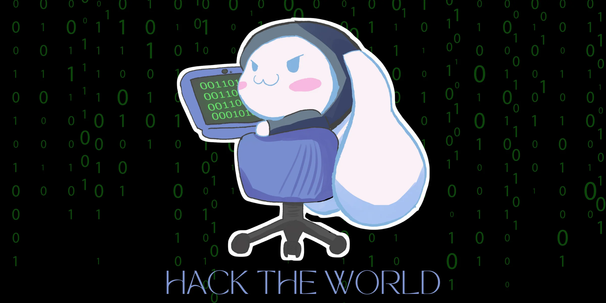

# **Cursos gratis**
Esta página esta pensada en poner recursos gratis y para dar a conocer a alumnos de estos recursos que las empresas ofrecen para formarse en el ambito de las tecnologia, programación y los diversos campos de la Ing. en Sistemas Computacionales.

## A quien va dirigida esta página
* Alumnos/Estudiantes
* y a gente que desee capacitarse de manera gratuita

### Recursos
El OWASP Top 10 es un informe estándar de concienciación y un documento crítico que enumera los 10 riesgos de seguridad más graves a los que se enfrentan las aplicaciones web

[Pagina OWASP](http://top10.owasp.org)

